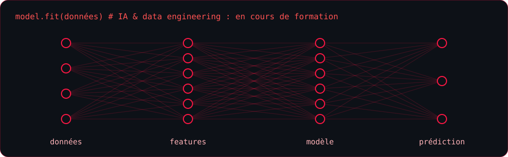
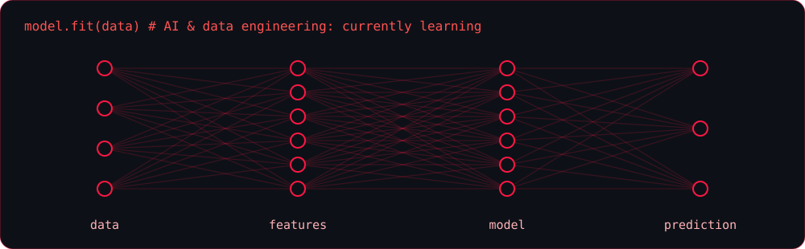

<!-- ============================================================
  PROFIL GITHUB - Samuel LABBE (SamFighter) - thème rouge
  À placer dans le dépôt SamFighter/SamFighter, avec le dossier "assets/"
  (header.svg, terminal.svg, neural.svg, pulse.svg) à la racine du dépôt.
  Les animations sont des SVG hébergés dans le dépôt : aucune dépendance
  à un service externe, donc rien qui disparaît.
============================================================ -->

<div align="center">
  
</div>

<br/>

<div align="center">
  
  
  
</div>

<div align="center">
  <sub>🇬🇧 <i>English version at the bottom of this page.</i></sub>
</div>

<br/>

<div align="center">
  
</div>


## 🧠 `./competences`

<div align="center">

**Langages que j'utilise au quotidien**


**Outils**


**Notions et en cours d'exploration**


<sub>Je préfère afficher ce que je maîtrise vraiment, et indiquer clairement ce que j'explore encore.</sub>

</div>


## 🚀 `./parcours --42`

<div align="center">
  
</div>

<br/>

<div align="center">

| 🔴 Domaine | 🎯 Ce que j'ai construit ou appris |
|:---:|:---|
| **🤖 Intelligence artificielle** | **ft_linear_regression** : régression linéaire codée à la main pour prédire le prix d'une voiture selon son kilométrage <br/> **DSLR** : classifieur « one-vs-all » par régression logistique, qui répartit les élèves de Poudlard dans leurs maisons |
| **📈 Data** | Lecture, nettoyage et visualisation de données (histogrammes, nuages de points, pair plots), et en formation sur le data engineering |
| **⚙️ Système & réseau** | **ft_irc** : serveur IRC multi-clients en C++98 (sockets, `poll`, I/O non bloquantes, salons, messages privés, commandes d'opérateur) |
| **🌐 Web** | **ft_transcendence** : application web full-stack avec interface en TypeScript |
| **🧱 Fondations C / C++** | Tronc commun : algorithmique, gestion de la mémoire, rigueur de la norme (libft, minishell…) |

</div>


## 🐍 `./contributions`

<!-- Le serpent apparaît après le premier lancement de l'Action .github/workflows/snake.yml -->
<div align="center">
  <picture>
    <source media="(prefers-color-scheme: dark)" srcset="https://raw.githubusercontent.com/SamFighter/SamFighter/output/github-contribution-grid-snake-dark.svg" />
    <source media="(prefers-color-scheme: light)" srcset="https://raw.githubusercontent.com/SamFighter/SamFighter/output/github-contribution-grid-snake.svg" />
    
  </picture>
</div>


## 📫 `./contact`

<div align="center">
  <a href="https://www.linkedin.com/in/samuel-labbe">
    
  </a>
  <a href="mailto:labbe.samuel@icloud.com">
    
  </a>
</div>

<br/>

<details>
<summary>🥚 <b>Easter egg : cliquez ici si vous recrutez</b></summary>

<br/>

```console
$ sudo hire samuel
[sudo] mot de passe pour recruteur: ********
Permission accordée.
> Alternance ou stage de 6 mois en Charente. Écrivez-moi, je réponds vite !
```

</details>

<br/>

<div align="center">
  <sub><i>« Apprendre en construisant, progresser en partageant. »</i></sub>
</div>


<details>
<summary>🇬🇧 <b>English version (click to expand)</b></summary>

<br/>

<div align="center">
  
</div>

<br/>

<div align="center">
  
  
  
</div>

<br/>

<div align="center">
  
</div>

## 🚀 `./journey --42`

<div align="center">
  
</div>

<br/>

<div align="center">

| 🔴 Field | 🎯 What I built or learned |
|:---:|:---|
| **🤖 Artificial intelligence** | **ft_linear_regression**: linear regression coded from scratch to predict a car's price from its mileage <br/> **DSLR**: one-vs-all classifier built with logistic regression, sorting Hogwarts students into their houses |
| **📈 Data** | Reading, cleaning and visualizing data (histograms, scatter plots, pair plots), and currently learning data engineering |
| **⚙️ Systems & networking** | **ft_irc**: multi-client IRC server in C++98 (sockets, `poll`, non-blocking I/O, channels, private messages, operator commands) |
| **🌐 Web** | **ft_transcendence**: full-stack web application with a TypeScript front end |
| **🧱 C / C++ foundations** | 42 core curriculum: algorithms, memory management, strict coding standards (libft, minishell…) |

</div>

<div align="center">

**About me:** student at 42 Angoulême, preparing an RNCP level 7 degree (master's level) in Web, Mobile, AI & Data Engineering. Fluent in English (written and spoken). Looking for an **apprenticeship** or a **6-month internship** in **Charente, France**.

📫 [LinkedIn](https://www.linkedin.com/in/samuel-labbe) • [Email](mailto:labbe.samuel@icloud.com)

</div>

</details>

<!--
============================================================
 OPTIONNEL : widgets de statistiques (services externes, parfois indisponibles).
 Pour les activer, supprime les marqueurs de commentaire autour du bloc.

<div align="center">
  
  
</div>
============================================================
-->